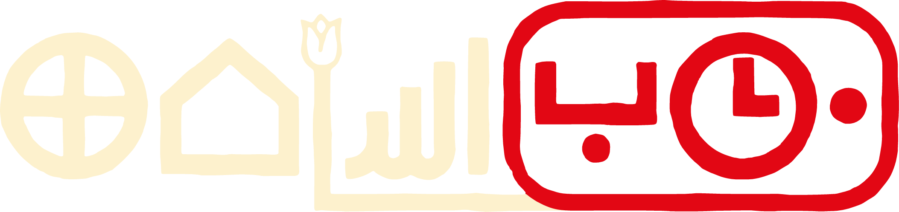

<picture>
  <source media="(prefers-color-scheme: dark)" srcset="logo/logo.png">
  <source media="(prefers-color-scheme: light)" srcset="logo/logo_pimeja.png">
  
</picture>

## nimi jan
mi toki pona e nimi jan tan toki Greek. (nasin kalama nasa pi toki Inli li weka la pona :p) nimi lawa li ken ante (tawa kule toki), taso, mute la, mi kepeken nimi "jan" tawa jan pi sewi ala li kepeken nimi "sewi" tawa jan sewi.

- **Orpheus**: **jan Opeju** `[open. jo uta]`
- **Eurydice**: **jan Eluteke** `[en luka. tenpo. ken.]`\
*(mi la ni la kalama "te" li pona tawa kalama "si")*
- **Persephone**: **sewi Pasepone** `[pan. seli. pona. nena.]`\
*(mi kalama "pa" e ona tan ni: sewi [pan] li nimi pona musi.)*
- **Hades**: **sewi Ate** `[anpa tenpo.]`
- **Hermes**: **sewi Eme** `[esun meso.]`
- **Fates**: **sewi Mola** `[monsi. lawa.]`

## nimi kalama

| nanpa | toki Inli | toki pona | pini |
| --- | --- | --- | --- |
| `01` | Road to Hell | | 108/108 (100%)|
| `02` | Any Way the Wind Blows | | 35/67 (52%)|
| `03` | Come Home With Me | | 39/45 (86%)|
| `04` | Wedding Song | | 49/57 (85%)|
| `05` | Epic I | |  |
| `06` | Livin' it Up on Top | |  |
| `07` | All I've Ever Known | |  |
| `08` | Way Down Hadestown | |  |
| `09` | A Gathering Storm | |  |
| `10` | Epic II | |  |
| `11` | Chant | |  |
| `12` | Hey, Little Songbird | |  |
| `13` | When the Chips are Down | |  |
| `14` | Gone, I'm Gone | |  |
| `15` | Wait for Me | |  |
| `16` | Why We Build the Wall | |  |
| `17` | Our Lady of the Underground | |  |
| `18` | Way Down Hadestown II | |  |
| `19` | Flowers | |  |
| `20` | Come Home With Me II | |  |
| `21` | Papers | |  |
| `22` | Nothing Changes | |  |
| `23` | If it's True | |  |
| `24` | How Long? | |  |
| `25` | Chant II | |  |
| `26` | Epic III | |  |
| `27` | Promises | |  |
| `28` | Word to the Wise | |  |
| `29` | His Kiss, the Riot | |  |
| `30` | Wait for Me II | |  |
| `31` | Doubt Comes In | |  |
| `32` | Road to Hell II | |  |
| `33` | We Raise Our Cups | |  |

## sona namako
lipu mi li jo ala e ni: nasin toki. (jan li toki tawa jan seme, tan pilin seme?) mi poka pini la mi nasin e toki ale ni tawa lipu anu sitelen la mi o pana e ni.

tenpo kama la mi wile kalama e ni. ken la mi wile e mu pi jan ante, ken la mi wile e mu mi taso. ken la mi ante e kule pi mu mi kepeken ilo. msx.

lon la, nasin lawa, la mi ken ala pana e ni - mi jo/lawa ala e lipu Hadestown. ken la, pali mi li lili lon toki lili la, jan lawa li pilin ike ala :p. pali ale ni li tawa mi taso, ona li mani ala tawa mi, taso mi wile e ni: jan pi toki pona li ken lukin e ijo pona pi toki pona!